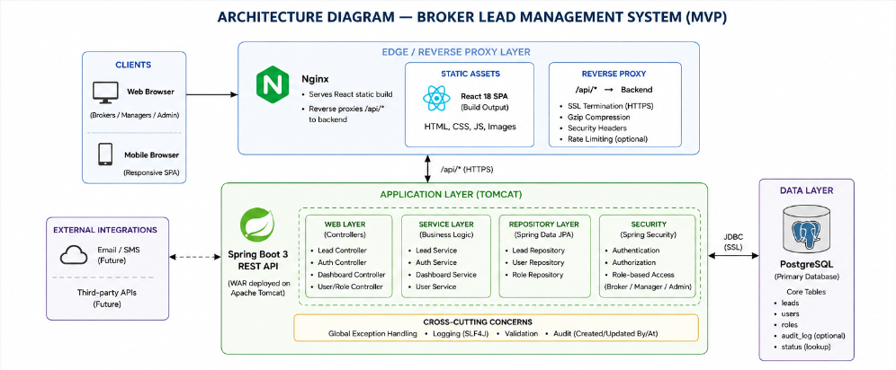
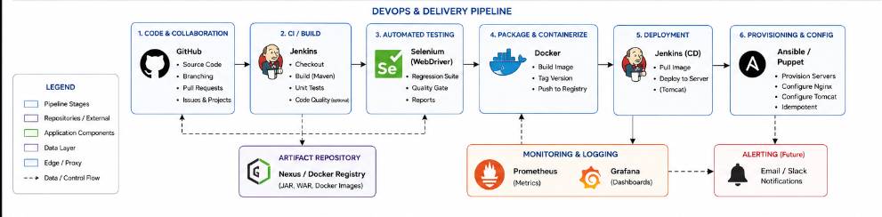

# Broker Lead Management System (BLMS)

## What this is

A web app for brokers to add, view, update, and search leads through a status workflow, with a dashboard for managers to track lead volume by status.

Built over 15 weeks as a full DevOps project. The app, the CI/CD pipeline, the automated tests, the containers, and the server automation are all part of the deliverable, not just the app itself.

## Scope

- Add, view, update, and search leads
- Status workflow: New, Contacted, Qualified, Converted or Lost
- Dashboard with lead counts by status
- Role-based access for brokers, managers, and admins

Not included: notifications, third-party lead integrations, advanced reporting, a mobile app, multi-branch support.

## Architecture

Browser (React) to Nginx to the Spring Boot backend to PostgreSQL.

## Delivery pipeline

## Stack

- Frontend: React 18, Vite
- Backend: Java 17, Spring Boot 3
- Database: PostgreSQL 16
- Build: Maven, npm
- Deploy: embedded Tomcat in Spring Boot, Nginx
- CI/CD: Jenkins
- Testing: Selenium, JUnit
- Containers: Docker
- Config management: Ansible or Puppet

## 15-week plan

Week 1: Problem definition and scope. Done.
Week 2: Agile planning and DevOps workflow. Done.
Week 3: Architecture and tech stack. Done.
Week 4: GitHub repo setup. Done.
Week 5: First feature, branch workflow.
Week 6: Rest of the MVP, Git collaboration.
Week 7: Jenkins install, CI job.
Week 8: Pipeline as code, server deploy.
Week 9: Selenium tests, local run.
Week 10: Tests as a Jenkins gate.
Week 11: Docker image, container lifecycle.
Week 12: Jenkins-Docker deploy.
Week 13: Config management script.
Week 14: Provisioning and rollback validation.
Week 15: Final release, docs, demo.

## Structure

    blms/
      backend/
        src/main/java/com/blms/
          controller/
          model/
          repository/
          service/
          config/
      frontend/
        src/
          components/
      docs/
      .github/

## Setup

You need JDK 17, Maven, Node.js, and a PostgreSQL 16 instance running locally.

Backend:

    cd backend
    mvn spring-boot:run

Runs on port 8081. Check it's up with:

    curl http://localhost:8081/api/v1/health

Frontend:

    cd frontend
    npm install
    npm run dev

Runs on port 5173 and proxies /api calls to the backend.

Database connection settings are in backend/src/main/resources/application.properties, or set these env vars:

    DB_URL=jdbc:postgresql://localhost:5432/blms
    DB_USERNAME=blms_user
    DB_PASSWORD=<your database password>

## Contributing

See CONTRIBUTING.md for branch naming, commit style, and PR process.

## License

MIT

## Authentication and environment

Login uses an HttpOnly server session cookie. API writes require a CSRF token from
`GET /api/v1/auth/csrf`; the frontend handles this automatically. Public signup creates
BROKER accounts. Only ADMIN accounts manage users; ADMIN and MANAGER accounts can
delete leads or set their status to CONVERTED/LOST. Account deactivation and role
changes take effect on existing sessions on their next request.

For local backend development, set `DB_URL`, `DB_USERNAME`, and `DB_PASSWORD` in the
shell before starting Maven. To create an initial admin, also set
`BLMS_ADMIN_EMAIL` and `BLMS_ADMIN_PASSWORD` (8 or more characters, at most 72 UTF-8 bytes).
Bootstrap creates the account only if the email does not exist; it never resets an
existing account's password or role. Remove the bootstrap password after initial setup.

For Docker, copy `.env.example` to `.env` and fill in `DB_PASSWORD` and the bootstrap
admin password. Run `docker compose up -d --build --wait --wait-timeout 180`.
Open http://localhost:3000. PostgreSQL and the backend bind to loopback on the host;
containers communicate over their internal network. Existing PostgreSQL volumes keep
their original database credentials: use those values when upgrading an existing install.

Demo accounts are created only when `BLMS_DEMO_DATA=true` on an empty database.
Keep this disabled for real deployments. Existing demo accounts from older installs
are not automatically deleted; replace their passwords or deactivate those accounts.
Set `SESSION_COOKIE_SECURE=true` when serving the app over HTTPS.

## Verification and release

- Backend unit and authenticated integration tests: `cd backend` then `mvn clean verify`.
- Frontend API regression tests: `cd frontend` then `npm test`.
- Frontend production build: `npm run build`.
- Browser tests require the complete running app, Chrome, and working credentials:
  set `BASE_URL`, `SELENIUM_EMAIL`, and `SELENIUM_PASSWORD`, then run
  `mvn test -Pselenium` in `backend`. An unavailable app fails this suite.

Jenkins uses a Windows agent with Node.js 20 or newer, Chrome, and configured tools
named `Maven-3.9.16` and `JDK-21`. It also needs the Pipeline, JUnit, Credentials
Binding, and Workspace Cleanup plugins. Set the Pipeline script path to `Jenkinsfile`
and choose the branch containing these changes in the job's SCM configuration.
The default build runs backend verification, frontend tests and production build,
then Selenium against that production frontend and an isolated H2 backend. No
database, Docker daemon or stored credentials are needed for the default build.
Ports 18081 and 15173 must be free. The test runner creates a temporary admin,
stops its own services, and archives service logs. ChromeDriver is resolved by
Selenium Manager, so allow outbound access for its first download.

To run the same browser gate locally after backend verification and frontend build:
`powershell -NoProfile -ExecutionPolicy Bypass -File ci/Test-Browser.ps1`.
Use `-Offline` only when Maven dependencies are already cached.

On Build with Parameters, enable `PUBLISH_IMAGES` to publish versioned images;
this requires Docker and `docker-hub` (username/password). Enable `DEPLOY_DOCKER`
to deploy on the agent using Compose v2 supporting `--wait`, plus
`blms-db-password` and `blms-admin-password` (secret text). Both options default
to false and only run after the browser gate succeeds. Use a dedicated deployment
agent if enabling deployment. The admin secret must match any existing deployed
admin; bootstrap does not reset passwords. Deployment verifies API and nginx health.

The final combined report preserving the original Week 1 to 3 content and diagrams
is `output/doc/BLMS_Report_Original_Weeks_1_to_3.docx`. Other report files in that
folder are earlier revisions. Temporary render images are excluded from Git.

Ansible targets Ubuntu. Supply `db_password` and optionally `admin_password` via
Ansible Vault, or export `DB_PASSWORD` and `BLMS_ADMIN_PASSWORD`. Provision with
`ansible-playbook playbook.yml --limit <target>`, then deploy with
`ansible-playbook deploy-playbook.yml --limit <target> -e image_tag=<published-tag>`.
The playbook pulls published registry images; it does not build missing sources.
Rollback with `ansible-playbook rollback-playbook.yml --limit <target> -e rollback_version=<previous-tag>`.
Rollback recreates application containers and causes a brief interruption. It does
not roll back the database; verify schema compatibility before reverting versions.

Historical release documents describe the original demonstration milestones; the
current source and verification results take precedence over earlier completion claims.
